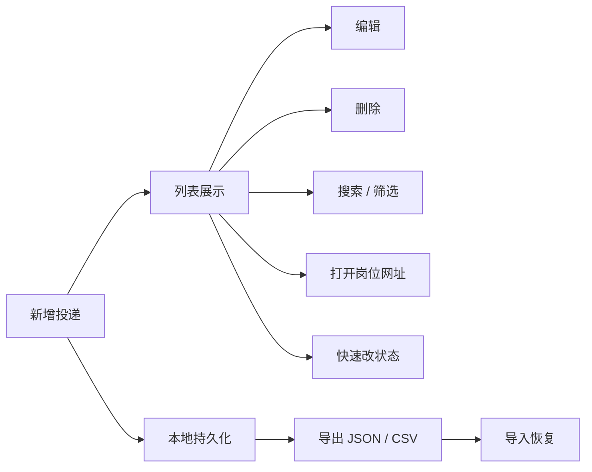

# 01 — 需求说明

> ⚠️ **历史存档（v1.0 本地版）**：本文描述的存储方式（IndexedDB）、导入导出、备注字段、无账号体系等内容已被 v2.0 Supabase 云端版取代，现状以 `../app/README.md` 与 `../工作进程.md` 为准。本文仅作需求沿革参考，请勿照此开发。

> 项目：JobCompass（校招投递记录本）
> 版本：v1.0 精简版
> 定位变更说明：由「投递管理 + LLM 简历匹配」收敛为**纯投递记录工具**，去掉项目库、JD 解析、匹配引擎等全部 AI 能力。

---

## 1. 一句话定位

**一个跑在浏览器里的校招投递记录本：记下投了哪些公司、什么岗位、岗位网址，一眼看清每家的进度。**

不做简历分析，不做 AI 建议，不做自动投递。只把"我投了什么、投到哪了"这件事做干净。

## 2. 目标用户与场景

**用户**：正在参加校招的应届生，一个人使用，数据量在 30–300 条之间。

**典型场景**：

| 场景 | 期望 |
| --- | --- |
| 刚在某公司官网投完递 | 30 秒内新增一条记录，把岗位链接一起存下来 |
| HR 打电话约面试 | 打开列表搜公司名，改状态为「面试」 |
| 想确认某家投的什么岗 | 搜公司，点链接直接回到原招聘页 |
| 周末复盘 | 看总数和各状态分布，知道还有几家在流程中 |
| 换电脑 / 清缓存前 | 导出 JSON 备份，到新环境导入 |

## 3. 功能范围

### 3.1 做什么（V1 全部功能）



| 编号 | 功能 | 说明 |
| --- | --- | --- |
| F-01 | 新增投递 | 表单录入公司、岗位、网址、日期、状态、渠道、备注 |
| F-02 | 列表展示 | 按投递日期倒序，卡片/表格两种密度 |
| F-03 | 编辑 | 点击记录打开侧边抽屉修改，自动保存 |
| F-04 | 删除 | 二次确认，支持撤销（5 秒内 Toast 撤回） |
| F-05 | 搜索 | 实时匹配公司名、岗位名、备注 |
| F-06 | 筛选 | 按状态筛选，可多选 |
| F-07 | 打开网址 | 点击链接触发新标签页；无网址时展示"未填" |
| F-08 | 复制网址 | 悬停出现复制按钮，复制后 Toast 提示 |
| F-09 | 快速改状态 | 点击状态徽章弹出下拉，选完立即保存 |
| F-10 | 统计概览 | 顶部显示总数、进行中、已 Offer、已挂 |
| F-11 | 导出 | JSON（全量备份）、CSV（Excel 可打开） |
| F-12 | 导入 | 选择 JSON 文件，合并或覆盖导入 |
| F-13 | 本地持久化 | 数据存浏览器 IndexedDB，刷新不丢 |
| F-14 | 响应式 | 手机浏览器可查看和改状态 |

### 3.2 不做什么

| 不做 | 原因 |
| --- | --- |
| 项目库、简历建议、LLM 调用 | 已在需求收敛中移除 |
| 账号登录、云同步 | 单机个人工具，引入账号即引入运维 |
| 时间线、面试轮次记录 | 备注字段可承载，V1 不建独立模型 |
| 提醒 / 通知 | 浏览器通知需要常驻进程，V2 再考虑 |
| 附件上传（简历 PDF） | IndexedDB 存二进制会显著膨胀 |

## 4. 数据字段

一条投递记录（Application）：

| 字段 | 类型 | 必填 | 默认值 | 说明 |
| --- | --- | --- | --- | --- |
| `id` | string | 是 | `crypto.randomUUID()` | 主键 |
| `company` | string ≤ 60 | **是** | — | 公司名称，如「字节跳动」 |
| `role` | string ≤ 80 | **是** | — | 岗位名称，如「后端开发工程师」 |
| `url` | string ≤ 500 | 否 | — | 岗位链接，自动补全 `https://` |
| `appliedAt` | string | **是** | 今天 | 投递日期，`YYYY-MM-DD` |
| `status` | enum | **是** | `applied` | 见 §5 |
| `channel` | enum | 否 | — | 官网 / 内推 / BOSS直聘 / 牛客 / 实习僧 / 校园宣讲 / 其他 |
| `note` | string ≤ 500 | 否 | — | 备注：内推码、HR 联系方式、面试时间等 |
| `createdAt` | number | 是 | `Date.now()` | 创建时间戳，用于稳定排序 |
| `updatedAt` | number | 是 | `Date.now()` | 更新时间戳 |

**字段校验规则**：

- `company`、`role` 去除首尾空格后不可为空。
- `url` 若填写，必须能被 `new URL()` 解析；不含协议时自动拼接 `https://`。允许 `http://`。
- `appliedAt` 不得晚于今天 + 1 天（允许时区误差），避免误填未来日期。
- `note` 与 `role` 中的换行统一转为空格存储。

## 5. 状态定义

| 值 | 展示名 | 颜色 | 语义 |
| --- | --- | --- | --- |
| `applied` | 已投递 | 蓝 | 简历已提交，等待反馈 |
| `written` | 笔试 | 紫 | 收到或完成笔试 |
| `interview` | 面试 | 橙 | 进入面试环节 |
| `offer` | 已 Offer | 绿 | 拿到录用意向 |
| `rejected` | 已挂 | 灰 | 明确拒信或长期无回应 |
| `withdrawn` | 已放弃 | 灰 | 主动放弃 |

规则：

- 状态可任意切换，不设流转约束（校招流程本身不线性）。
- `offer`、`rejected`、`withdrawn` 视为终态，默认在列表中正常展示，但统计区单独计数。
- 状态切换立即写入 `updatedAt`，列表上展示"最后更新于 N 天前"。

## 6. 页面与交互

### 6.1 页面结构

单页应用，一个主页面 + 一个抽屉表单 + 一个设置弹层：

```
┌─────────────────────────────────────────────────────────────┐
│ JobCompass           [搜索框]        [+ 新增]  [导入/导出]   │
├─────────────────────────────────────────────────────────────┤
│  总投递 46   进行中 12   已Offer 2   已挂 30                  │
├─────────────────────────────────────────────────────────────┤
│  [全部] [已投递] [笔试] [面试] [Offer] [已挂] [已放弃]         │
├─────────────────────────────────────────────────────────────┤
│ 字节跳动    后端开发工程师   已投递   07-12   [链接] [⋮]      │
│ 腾讯        后台开发         面试     07-08   [链接] [⋮]      │
│ ……                                                           │
└─────────────────────────────────────────────────────────────┘
```

### 6.2 新增 / 编辑表单

- 以右侧抽屉（Drawer）形式出现，宽度 480px；移动端占满全屏。
- 字段顺序：公司 → 岗位 → 岗位网址 → 投递日期 → 状态 → 渠道 → 备注。
- 公司输入框带**历史联想**（从已有记录的公司名去重）。
- 提交按钮固定底部，快捷键 `Ctrl/Cmd + Enter` 提交。
- `Esc` 关闭，有未保存修改时二次确认。

### 6.3 列表行交互

| 操作 | 触发 | 结果 |
| --- | --- | --- |
| 打开岗位页 | 点击网址图标 | 新标签页打开，`rel="noopener noreferrer"` |
| 复制链接 | 悬停网址图标 → 复制按钮 | 写入剪贴板 + Toast |
| 修改 | 点击行空白处 | 打开编辑抽屉 |
| 改状态 | 点击状态徽章 | 弹出下拉菜单，选中即保存 |
| 删除 | 行尾 `⋮` → 删除 | 确认弹窗，删除后 5 秒内可撤销 |
| 排序 | 顶部排序选择 | 投递日期 / 公司名 / 最近更新 |

### 6.4 空状态

- 无任何记录：「还没有投递记录，点右上角新增第一条」+ 主按钮。
- 搜索无结果：「没有找到包含"xxx"的记录」+ 清除筛选按钮。
- 筛选无结果：「当前筛选下没有记录」。

## 7. 数据导入导出

### 7.1 导出

| 格式 | 内容 | 用途 |
| --- | --- | --- |
| JSON | 全量记录 + 元信息（`version`、`exportedAt`、`count`） | 备份与恢复 |
| CSV | 表头中文，UTF-8 带 BOM | 用 Excel 查看或做二次分析 |

JSON 结构：

```json
{
  "app": "job-compass",
  "version": 1,
  "exportedAt": "2026-10-20T10:00:00.000Z",
  "count": 46,
  "applications": [
    {
      "id": "b3f1…",
      "company": "字节跳动",
      "role": "后端开发工程师",
      "url": "https://jobs.bytedance.com/…",
      "appliedAt": "2026-07-12",
      "status": "applied",
      "channel": "官网",
      "note": "",
      "createdAt": 1752300000000,
      "updatedAt": 1752300000000
    }
  ]
}
```

### 7.2 导入

- 仅接受本应用导出的 JSON（校验 `app === "job-compass"` 与 `version`）。
- 两种策略：
  - **合并**（默认）：`id` 已存在则保留较新的 `updatedAt`，不存在则新增。
  - **覆盖**：清空现有数据后写入。
- 导入前展示预览：「将新增 12 条，更新 3 条，跳过 1 条」。
- 版本不兼容时明确提示，不静默失败。

## 8. 非功能需求

| 维度 | 要求 |
| --- | --- |
| 首屏 | 本地打开 < 500ms，无网络请求（除字体外） |
| 数据量 | 1000 条记录下滚动流畅，无需分页 |
| 持久化 | 刷新、关闭浏览器、重启电脑后数据不丢 |
| 离线 | 构建产物可完全离线运行 |
| 隐私 | 不发起任何埋点或第三方请求 |
| 兼容 | Chrome / Edge 最新两个版本，移动端 Safari 可读可改 |
| 体积 | 构建产物 js + css < 300KB（gzip 前） |

## 9. 验收标准

- [ ] 必填项为空时提交被拦截，并定位到对应字段。
- [ ] 输入 `jobs.bytedance.com/123` 能自动补全为 `https://jobs.bytedance.com/123` 并成功保存。
- [ ] 新增一条记录后刷新页面，数据仍在。
- [ ] 搜索"字节"能命中公司名或岗位名包含该词的所有记录。
- [ ] 状态徽章点击可切换，切换后统计数字同步更新。
- [ ] 删除后 5 秒内点击"撤销"能恢复该记录且字段完整。
- [ ] 导出 JSON → 清空数据 → 导入该 JSON，记录数量与内容完全一致。
- [ ] 导出 CSV 用 Excel 打开，中文不乱码，列顺序与表头正确。
- [ ] 手机宽度 375px 下可完成新增与状态修改，无横向滚动。
- [ ] 断网状态下所有功能可正常使用（无外部依赖）。

## 10. 版本规划

| 版本 | 内容 |
| --- | --- |
| **V1.0** | 本文档 §3.1 全部功能（F-01 ~ F-14） |
| V1.1 | 看板视图（按状态分列拖拽）、按月份分组、快捷键（`/` 搜索、`n` 新建） |
| V1.2 | PWA 安装到桌面、本地通知提醒（面试日期）、深色模式 |
| V2.0 | 如需恢复 AI 能力：新增项目库与匹配模块，数据层从 IndexedDB 迁移到 SQLite + Next.js |
